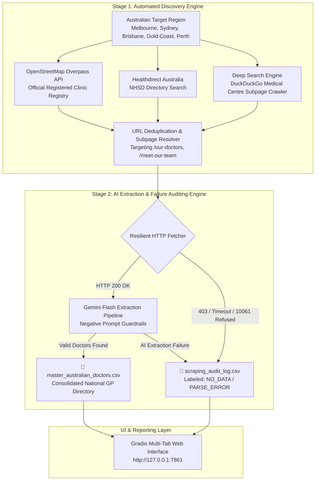

# 🩺 MIRA: AI-Powered Australian Medical Directory Scraper (Lite & Pro)

[](https://www.python.org/)
[](https://gradio.app/)
[](https://aistudio.google.com/)
[](https://pandas.pydata.org/)
[](https://opensource.org/licenses/MIT)

> **AI Growth & Automation Practical Assessment — Gokul Infocare**  
> **Candidate:** Sanjay Mathivanan  
> **Domain Focus:** Healthcare & Technology • Web Scraping & Data Intelligence  

---

## 📌 Project Overview

**MIRA** is a comprehensive, production-grade data intelligence pipeline designed to discover, crawl, structure, and audit publicly available directory data for **General Practitioners (GPs) across Australia**.

The project is structured into two complementary systems:
1. **MIRA-Lite (Tab 1):** An on-demand single-clinic scraper strictly meeting the Task 1 assessment rubric. Users paste an Australian clinic URL to extract doctor details into an interactive table and downloadable CSV.
2. **MIRA-Pro (Tab 2):** An automated **2-Stage Multi-Source Discovery & Bulk Crawler** that discovers clinics across Australian regions using 3 independent registries, extracts doctor rosters with Gemini, and categorizes any failed or blocked URLs into a rigorous **Scraping Audit Log**.

---

## 🏗️ 2-Stage Multi-Source Architecture



---

## ✨ Key Features & Technical Innovation

- **Multi-Source Discovery Engine:** Combines **OpenStreetMap Overpass API**, **Healthdirect / NHSD**, and **DuckDuckGo Deep Search** to harvest clinic domains without manual searching.
- **Deep Subpage Resolver:** Automatically inspects clinic homepages to detect and follow internal doctor roster links (`/our-doctors`, `/meet-our-team`, `/practitioners`).
- **Resilient AI Extraction:** Leverages **Google Gemini Flash** with few-shot schema constraints and an automatic high-traffic fallback cascade (`gemini-flash-latest` ➔ `gemini-flash-lite-latest` ➔ `gemini-3.8-flash` ➔ `gemini-pro-latest`) to withstand free-tier rate limits and traffic spikes.
- **Granular Failure Auditing:** Unlike standard scrapers that crash or silently drop failed sites, MIRA logs every single URL in `scraping_audit_log.csv` with explicit status codes and reasons (`HTTP 403 Cloudflare Blocked`, `Connection Refused (Server Down)`, `Timeout Exceeded (>10s)`, `No Doctors Identified`).
- **Enterprise-Grade Scalability:** Built upon data pipeline methodologies proven during the candidate's work processing 150,000+ files at BMW Plant Chennai.

---

## 📊 Dual CSV Deliverables

| File | Description | Key Columns |
| :--- | :--- | :--- |
| **`master_australian_doctors.csv`** | Consolidated directory of all successfully extracted GPs | `Name`, `Specialty`, `Working Hours`, `Clinic_Name`, `Region`, `Clinic_URL`, `Discovery_Source`, `Extracted_At` |
| **`scraping_audit_log.csv`** | Comprehensive tracking and failure diagnosis for every visited domain | `Clinic_Name`, `Target_URL`, `Region`, `Status` (`SUCCESS`/`FAILED`), `HTTP_Status`, `Failure_Reason`, `Doctors_Extracted`, `Duration_Sec` |

---

## 🚀 Quick Start Guide

### 1. Clone & Setup
```bash
git clone https://github.com/YOUR_GITHUB_USERNAME/MIRA-Medical-Scraper.git
cd MIRA-Medical-Scraper

python -m venv venv
venv\Scripts\activate   # Windows
# source venv/bin/activate # macOS/Linux

pip install -r requirements.txt
```

### 2. Configure API Key
```powershell
$env:GEMINI_API_KEY="your-gemini-api-key-here"
```

### 3. Launch the Web Interface
```powershell
python app.py
```
Open **`http://127.0.0.1:7861`** in your browser.

- **Tab 1:** Run instant single-clinic extractions.
- **Tab 2:** Select a region (e.g. Melbourne), set max clinics, and run the automated multi-source crawler.

### 4. Or Run via CLI
```powershell
python batch_scraper.py Melbourne 5
```

---

## 📁 Repository Structure

```text
├── app.py                      # Multi-tab Gradio web app (MIRA-Lite + MIRA-Pro)
├── discovery.py                # Multi-source clinic discovery (OSM, Healthdirect, DDG)
├── pipeline.py                 # Batch extraction pipeline & failure auditing engine
├── batch_scraper.py            # Command-line multi-clinic runner
├── requirements.txt            # Project dependencies
├── Prompt_Documentation.pdf    # Deliverable 2: Complete prompt engineering history
├── README.md                   # Technical documentation and architecture guide
├── master_australian_doctors.csv # Consolidated master dataset
└── scraping_audit_log.csv      # Detailed audit trail of successes and labeled failures
```

---

## 🎯 Deliverables Summary

- **Deliverable 1: 2-Minute Video Presentation**  
  [Link to Video Presentation (Google Drive)](https://drive.google.com/your-video-link-here)
- **Deliverable 2: Prompt Documentation**  
  Full history of prompt iterations and architectural decisions documented in [Prompt_Documentation.pdf](./Prompt_Documentation.pdf).
- **Deliverable 3: Project Repository & Code**  
  Complete codebase committed and verified in this repository.

---

## 👨‍💻 Candidate Information

- **Candidate:** Sanjay Mathivanan
- **Position Applied:** AI Growth & Automation Associate
- **Company:** Gokul Infocare
- **Submission Email:** jobs@gokulinfocare.com
